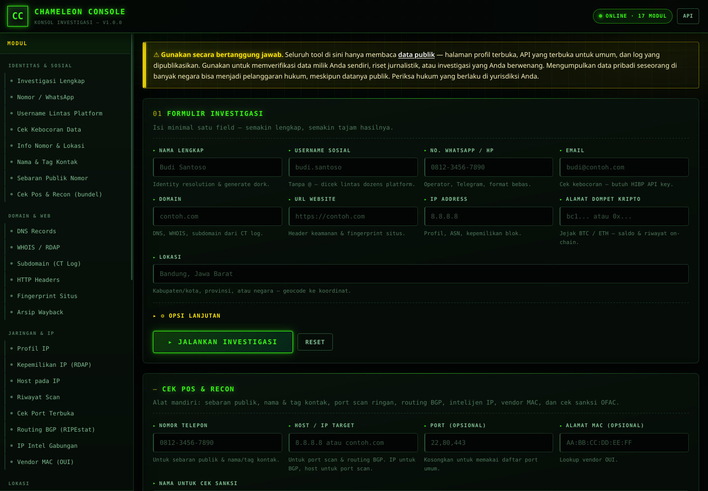

# Chameleon Console

[](https://github.com/klickcoDe/chameleon-console/actions/workflows/ci.yml)
[](https://gitlab.com/klickcoDe/chameleon-console/-/pipelines)
[](CHANGELOG.md)
[](LICENSE)
[](package.json)
[](package.json)

Konsol investigasi OSINT lokal dengan antarmuka web bertema neon. Satu form,
delapan kolom input (nama, username, nomor, email, domain, URL, IP, lokasi),
dan 39 tool di belakangnya: enumerasi sosial, verifikasi nomor,
**nama & tag kontak** (nama yang disimpan orang lain untuk sebuah nomor),
**profil & lokasi nomor** (negara, area, zona waktu), **recon domain**
(DNS/WHOIS/subdomain/header), **profil jaringan** (IP/ASN/reverse), **port scan
ringan**, **recon ala OSIRIS** (BGP, vendor MAC, sanksi OFAC), **forensik**
(hash/dekoder/password), **reputasi** (tag & skor spam), **kelemahan website**
(TLS/path terbuka/security.txt), **intelijen ancaman** (jejak dompet kripto,
CVE), geocode, cek kebocoran, dan ekspor entity ke Maltego.

**Nol dependensi.** Hanya modul bawaan Node.js — tidak ada `npm install`.

## Demo

Alamat daring proyek ini: **<https://chameleon-console.vercel.app>**

Domain di atas adalah alamat resmi proyek. Bila instance-nya belum berjalan,
aktifkan lewat salah satu panduan berikut:

- [docs/vercel.md](docs/vercel.md) — UI statis di Vercel, API di container.
- [docs/deploy.md](docs/deploy.md) — UI + API satu domain (container atau systemd).

`http://localhost:3000` hanya alamat lokal saat server dijalankan di mesin
sendiri; jangan dipakai sebagai tautan publik.

## Tampilan



---

## Jalankan

### Tanpa Docker (lokal)

```bash
cd chameleon-console
node server.js          # atau: npm start
```

Buka <http://localhost:3000> — alamat lokal di mesin ini.

Butuh Node.js 20.12 ke atas (memakai `process.loadEnvFile` bawaan). Uji seluruh modul dengan:

```bash
npm run smoke
```

### Dengan Docker (direkomendasikan untuk production)

Berkas `Dockerfile` dan `docker-compose.yml` sudah disertakan. Proyek ini
**zero-dependency** — tidak ada `npm install`, image cukup kecil (~90 MB).

```bash
# 1. Salin contoh konfigurasi
cp .env.example .env
# 2. Isi .env (CONTACT_NAME dan CONTACT_EMAIL wajib agar API pihak ketiga
#    tidak memblokir permintaan Anda).
# 3. Jalankan
docker compose up -d
```

Buka <http://localhost:3000> — alamat lokal di mesin ini.

Atau dengan `docker run` langsung:

```bash
docker build -t chameleon-console:1.0.0 .
docker run -d --name chameleon-console --restart unless-stopped \
  -p 127.0.0.1:3000:3000 \
  --env-file .env \
  -v chameleon-data:/app/data \
  --memory 512m --cpus 1 \
  chameleon-console:1.0.0
```

Riwayat investigasi (`data/history.jsonl`) dan cache OFAC disimpan dalam
volume `chameleon-data`, sehingga tidak hilang saat container dihapus.

> **Untuk production**, ikuti [docs/deploy.md](docs/deploy.md): systemd,
> reverse proxy + HTTPS + autentikasi, `TRUST_PROXY`, backup, dan checklist
> go-live. Server bawaan tidak punya login.

Pemeriksaan pihak ketiga (mesin pencari, RDAP, RIPEstat) akan ditandai
**dilewati** — bukan "gagal" — kalau sumbernya sedang tidak merespons.
Kegagalan jaringan bukan bug kode, dan statusnya dilaporkan apa adanya,
bukan disamarkan.

> Folder proyek bernama `chameleon-console`. Kalau Anda memindahkannya,
> sesuaikan hanya baris `cd` di atas — tidak ada path absolut di dalam kode.

---

## Isi form

| Kolom | Dipakai untuk |
|---|---|
| **Nama Lengkap** | Identity resolution, generate dork, node `Person` di graph |
| **Username Media Sosial** | Pencarian profil di 50 platform sekaligus |
| **No. WhatsApp / No. HP** | Deteksi operator, cek Telegram, tautan verifikasi WA, **nama & tag kontak**, **profil nomor** |
| **Email** (opsional) | Cek kebocoran data via Have I Been Pwned |
| **Domain** (opsional) | DNS, WHOIS/RDAP, subdomain dari CT log |
| **URL** (opsional) | Probe header keamanan + fingerprint situs |
| **IP** (opsional) | Profil IP, ASN, kepemilikan blok |
| **Lokasi** | Geocode ke koordinat, disruz dengan nama untuk dork |

Modul domain & jaringan bersifat opsional (centang di "Opsi Lanjutan") karena
menambah beberapa detik dan sering tidak relevan.

Ada juga panel **"Cek Pos & Recon"** terpisah di bawah laporan — alat mandiri
untuk sebaran publik, nama & tag kontak, port scan, routing BGP, intelijen IP,
vendor MAC, dan cek sanksi OFAC.

---

## Tata letak

UI memakai pola **app shell full-bleed**, bukan kolom terpusat:

- **Tanpa padding kiri/kanan halaman.** Tidak ada `max-width` terpusat lagi —
  lebar halaman dipakai penuh, jadi tidak ada margin kosong di kiri dan kanan
  pada layar lebar.
- **Rail sidebar flush kiri.** Panel modul melekat tepat di `x = 0`, menempel
  di bawah topbar, dan setinggi area kerja (`100vh - 66px`). Daftar modul
  digulir di dalam rail, bukan terpotong.
- **Kolom konten** dimulai setelah rail dengan jarak kerja 18 px
  (`--gutter`) supaya kartu tidak menempel ke panel sidebar atau tepi jendela.
- **Topbar** memakai grid yang sama dengan layout utama: brand sejajar dengan
  kolom rail, tombol aksi rata kanan di kolom konten.
- Di bawah 940 px layout turun ke satu kolom: rail kembali jadi panel dengan
  margin, topbar kembali ke susunan flex.

Variabel yang mengatur semua ini: `--rail` (272 px), `--gutter` (18 px),
`--topbar-h` (66 px) — semuanya di `public/style.css`.

---

## Modul (v1.0.0)

### Domain & Web (`src/modules/domain.js`)

| Tool | Sumber | Catatan |
|---|---|---|
| DNS Records | Google DoH | A/AAAA/MX/NS/TXT/SOA/CNAME, bukan resolver OS |
| WHOIS / RDAP | `rdap.org` | Protokol resmi penerus WHOIS; JSON terstruktur |
| Subdomain | CertSpotter + crt.sh | CT log — jejak nyata, bukan tebakan |
| HTTP Headers | probe langsung | Skor header keamanan + atribut cookie |
| Fingerprint | HTML publik | Judul, meta, framework/tech terdeteksi |
| Arsip Wayback | Internet Archive | Riwayat tangkapan layar |

**Kenapa RDAP, bukan WHOIS lama?** Protokol WHOIS port 43 diblokir sebagian
jaringan dan output-nya tidak terstruktur. RDAP memberi JSON dari registrar yang
sama, dan kini jadi standar ICANN.

**crt.sh sering tidak stabil.** Sumber utama adalah CertSpotter (gratis, tanpa
key); crt.sh hanya cadangan. Kalau crt.sh balas 502, modul melaporkannya
sebagai `ok: false` di `sources[]` — tidak disembunyikan, dan tidak membuat
seluruh subdomain ikut gagal.

### Jaringan & IP (`src/modules/network.js`)

| Tool | Sumber |
|---|---|
| Profil IP | ip-api.com + ipinfo.io (digabung, salah satu mati pun tetap jalan) |
| Kepemilikan IP | RDAP resmi (arin/ripe/apnic) |
| Host pada IP | hackertarget reverse IP |
| Riwayat scan | urlscan.io (hanya scan publik) |

**Reverse IP tidak lengkap.** Hanya host dengan reverse DNS yang muncul —
banyak host tidak akan terlihat. Ini batas nyata, disclosed di `note`.

### Nama & Tag Kontak (`src/modules/contacts.js`)

Ini jawaban untuk pertanyaan: **"orang lain biasanya menyimpan nomor ini
dengan nama/label apa?"** — misalnya *CS Tokopedia*, *akun pinjol*, *toko
online*, atau *teman lama*.

| Yang dikumpulkan | Cara |
|---|---|
| Nama pemanggil / nama toko | Jejak nomor di halaman publik + pola "nama:", "atas nama", "dari … menelepon" |
| Label peran & kategori | Kamus pola (CS, admin, sales, reseller, rekrutmen, toko online, e-wallet, kurir, properti, donasi, ...) |
| Indikasi negatif | Pola "penipu", "spam", "blacklist", "judol/togel" |
| Nama tampilan Telegram | `t.me/+<nomor>` — nama yang dipilih **pemilik** nomor, dicatat terpisah |

**Cara menghitung "paling sering dipakai":** setiap label dihitung berdasarkan
**berapa banyak situs berbeda** yang memakainya, bukan jumlah kemunculan di satu
situs. Label yang muncul di ≥2 situs independen diberi `confidence: "high"`,
dan setiap tag membawa bukti (situs + judul + cuplikan + tautan) supaya bisa
Anda verifikasi sendiri.

**Yang SENGAJA tidak dilakukan: mengikis Truecaller / GetContact / Kredibel.**
Data "nama kontak tersimpan" di sana dibangun dari opt-in pengguna dan tidak
dibuka lewat API — mengikisnya berarti melanggar ToS situs tersebut. Sebagai
gantinya, modul ini **menyodorkan tautan** ke layanan-layanan itu untuk Anda
periksa sendiri secara manual (satu klik), plus catatan jujur bahwa kalau
tidak ada jejak publik, jawabannya memang kosong.

Tersedia juga sebagai tool mandiri: `POST /api/contact-names`.

### Sebaran Publik (`src/modules/mentions.js`)

Mencari halaman/posting yang **menyebut nomor** — pengumuman toko, listing,
thread forum, pemberitaan, laporan penipuan.

| Sumber | Jenis |
|---|---|
| DuckDuckGo (HTML) | hasil pencarian web |
| Bing (HTML) | hasil pencarian web (redundansi) |
| Google News (RSS) | penyebutan di pemberitaan |
| Stack Exchange (API) | penyebutan di forum teknis |
| urlscan.io (API) | halaman yang pernah discan publik |

Semua keyless. Setiap sumber dilaporkan statusnya sendiri (`sources[]`), jadi
satu mesin yang diblokir tidak membuat modul ini gagal diam-diam.

**Saringan relevansi.** Mesin pencari sering mengembalikan halaman yang
kebetulan memuat angka serupa. Hanya hasil yang **benar-benar memuat nomor**
yang dipertahankan (dicek dengan normalisasi digit, jadi "0812 3456-7890" tetap
cocok dengan "081234567890"), dan jumlah yang dibuang dilaporkan sebagai
`filteredOut`.

### Info Nomor & Lokasi (`src/modules/phoneinfo.js`)

Padanan `phone_number_cheker` (libphonenumber) + route `/api/osint/phone` di
OSIRIS. Menjawab: *negara mana, operator siapa, tipe baris apa, area
pendaftaran di mana, jam berapa sekarang di sana?*

| Sumber | Isi |
|---|---|
| `src/util/phone-meta.js` (offline) | Tabel E.164 ~120 kode negara, kode area Indonesia, peta prefix → zona waktu |
| Numverify (opsional, butuh key) | Konfirmasi operator, tipe baris, status porting |

**Yang ditampilkan:** negara, operator, tipe baris (seluler/landline/toll-free),
`possible`/`valid` (panjang & pola awalan), kode area + kota **hanya untuk
landline**, serta zona waktu + waktu lokal + offset UTC.

**Yang tidak ditampilkan, dan alasannya.** Untuk nomor **seluler**, kota
TIDAK bisa diturunkan dari prefix — alokasi seluler Indonesia tidak memuat
kode area, jadi modul ini sengaja menampilkan `city: null` untuk nomor
seluler daripada mengarang kota. Prefix juga tidak terikat wilayah (nomor bisa
dipakai di luar wilayah alokasi awal dan bisa diporting), jadi zona waktu
seluler hanya berlabel "perkiraan lemah".

**Lokasi GPS real-time dari nomor telepon tidak tersedia untuk publik.** Data
HLR/LBS milik operator dan tidak dipublikasikan. Modul ini menulis "perkiraan"
di mana pun itu yang terjadi dan tidak pernah menampilkan titik koordinat
seolah-olah itu lokasi perangkat.

### Cek Port Terbuka (`src/modules/portscan.js`)

Port scan ringan gaya OSIRIS, dibatasi keras:

- hanya **TCP CONNECT** (tanpa SYN stealth, tanpa UDP),
- hanya daftar port umum (atau daftar custom: `"22,80,443"`, `"20-25"`),
- concurrency rendah (default 16), timeout pendek (default 2 detik),
- **tanpa banner grabbing**, tanpa payload, tanpa eksploitasi.

Modul ini **tidak pernah** dijalankan otomatis saat investigasi form — hanya
lewat tool terpisah `POST /api/port-scan` atau panel "Cek Pos & Recon".

> ⚠️ Port scan terhadap sistem milik orang lain tanpa izin adalah pelanggaran
> hukum di banyak yurisdiksi (UU ITE di Indonesia, CFAA di AS, dsb). Jalankan
> hanya terhadap sistem milik Anda sendiri atau sistem yang Anda punya izin
> tertulis.

### Recon OSIRIS (`src/modules/osiris.js`)

| Tool | Sumber | Isi |
|---|---|---|
| Routing BGP | RIPEstat (keyless) | Prefix yang diumumkan, AS pengeriksa, status RPKI |
| Vendor MAC | macvendors.com | Vendor OUI (3 byte pertama) |
| Sanksi OFAC | SDN + ALT CSV (treasury.gov) | Daftar resmi orang/organisasi yang dibekukan asetnya |
| IP Intel | gabungan | Profil GeoIP + routing BGP |

Daftar OFAC di-cache lokal di `data/ofac/` dengan masa berlaku 24 jam
(≈19.500 entri), sehingga pencarian nama berjalan cepat dan tidak membebani
server AS. Cocok nama **bukan** bukti identitas — nama orang bisa sama;
verifikasi di `sanctionssearch.ofac.treas.gov`.

### Cek Pos & Recon (`src/modules/cekpos.js`)

Bundel dari tiga gaya pemeriksaan yang sering diminta sekaligus:

1. **Sebaran publik** — posting/mention yang menyebut nomor,
2. **Nama & tag kontak** — tag yang paling sering dipakai orang lain,
3. **Port scan ringan** + **routing BGP** + **IP intel** + **vendor MAC** +
   **sanksi OFAC**.

Setiap bagian yang tidak dijalankan **tidak boleh hilang begitu saja**: bagian
yang dilewati tetap muncul di `parts[]` dengan `skipped: true` beserta
alasan (`reason`). Port scan hanya jalan kalau target host/IP diisi eksplisit —
modul ini tidak pernah memilih target sendiri.

### Forensik (`src/util/crypto.js`)

| Tool | Keterangan |
|---|---|
| Hash | MD5/SHA-1/SHA-256/SHA-512, 100% lokal |
| Identifikasi hash | Deteksi lewat panjang + pola (JWT, alamat kripto, hex) |
| Dekoder | base64 / JWT / URL / hex, otomatis |
| Analisis password | Entropi + skor kekuatan, offline |

**Tidak ada data yang dikirim ke pihak ketiga** dari modul forensik. Hash dan
password dihitung sepenuhnya di memori server.

**JWT tidak diverifikasi signature-nya.** Isi payload adalah klaim yang
dicantumkan penerbit token, bukan fakta terverifikasi.

### Perbaikan jaringan yang diterapkan

Node 20+ memakai "Happy Eyeballs": mencoba IPv6 dan IPv4 bersamaan. Di
jaringan yang punya AAAA record tapi tanpa jalur IPv6 (container, sebagian VPN),
Node gagal total meski IPv4 sehat — gejala nyata: `fetch` ke certspotter
`UND_ERR_CONNECT_TIMEOUT` sementara `curl` sukses 200. `src/loadenv.js` sekarang
memaksa urutan IPv4 lebih dulu. Set `OS_FAVOR_IPV6=1` untuk membatalkan.

### Reputasi & Tag (`src/modules/reputation.js`)

| Tool | Sumber | Catatan |
|---|---|---|
| Tag & skor spam nomor | StopForumSpam + aturan lokal | Skor 0–100 **beserta alasannya**, bukan vonis |
| Reputasi username | StopForumSpam (crowdsourced) | Laporan komunitas, keyless |
| Dork reputasi | generator query offline | Nomor tidak dikirim ke API mana pun |

Modul reputasi mengembalikan **skor + alasan**, dan selalu menyertakan catatan
bahwa ini indikator, bukan bukti. (Berbeda dengan modul *nama & tag kontak*,
yang memakai jejak publik + penghitungan lintas situs.)

### Kelemahan Website (`src/modules/websec.js`)

| Tool | Keterangan |
|---|---|
| Analisis sertifikat TLS | chain, masa berlaku, SAN, temuan |
| Path sensitif terbuka | satu GET per path, **hanya status** |
| security.txt & robots.txt | RFC 9116 + ringkasan robots |
| Posture web lengkap | gabungan TLS + security.txt + skor |

**Penilaian pasif, bukan penetration test.** Tidak ada brute force, login
attempt, atau eksploitasi; setiap pemeriksaan satu request GET/HEAD — persis
seperti browser biasa. Muatan dari path yang terbuka **tidak** diambil, hanya
statusnya.

> Port scan **tidak** termasuk bagian modul ini. Port scan ada sebagai tool
> terpisah (`src/modules/portscan.js`) yang hanya berjalan atas target yang
> Anda tentukan sendiri — lihat bagian "Cek Port Terbuka" di atas.

### Intelijen Ancaman (`src/modules/threatintel.js`)

| Tool | Sumber | Keterangan |
|---|---|---|
| Jejak dompet (BTC/ETH) | blockstream.info (Esplora) + eth.blockscout.com | saldo, jumlah transaksi, first/last seen |
| Cari CVE | NVD API 2.0 (keyless) | CVE ID + skor CVSS + ringkasan |
| CVE per produk/versi | NVD | pencocokan versi produk dengan CVE |

**Alamat kripto bukan identitas.** Data on-chain memang publik, tapi alamat
publik bukan bukti kepemilikan — siapa pun bisa menyimpan di alamat yang sama.
Label di Blockscout berasal dari komunitas dan bisa dipalsukan. Perlakukan
sebagai indikator, bukan identitas terverifikasi.

---

## Yang benar-benar bekerja, dan yang tidak

Bagian ini penting. Banyak tool OSINT menampilkan hasil yang mereka karang
sendiri; di sini setiap status disertai cara pembuktiannya.

### Nomor telepon — verifikasi operator

Nomor dinormalisasi ke E.164 dari input bebas (`0812-3456-7890`,
`+62 812…`, `62812…`, `812…`), lalu operator ditebak dari prefix
(Telkomsel/Indosat/XL/AXIS/Smartfren/by.U) dan lokasi kab/kota operator
diambil dari ip-api.com.

### Nama kontak — yang bisa, dan yang memang mustahil

| Kemungkinan | Status |
|---|---|
| Nama/tag yang muncul bersama nomor di halaman publik | ✅ bisa — dihitung lintas situs, lengkap dengan bukti |
| Nama yang disimpan orang lain di HP-nya | ⚠️ hanya lewat GetContact/Truecaller/Kredibel — **manual**, tautannya disediakan |
| Menebak nama pemilik dari nomor | ❌ tidak dilakukan sama sekali |

Modul ini **tidak pernah mengarang nama**. Kalau tidak ada jejak publik,
hasilnya kosong — dan itu jawaban yang benar, bukan kegagalan.

### Lokasi — tidak ada pelacakan GPS

Tidak ada tool publik (bukan juga yang OSIRIS/phone_number_cheker) yang bisa
menunjukkan posisi GPS perangkat dari nomor telepon. Yang bisa adalah
**footprinting**: nama/label yang orang simpan, negara, operator, tipe
garis (GSM/VoIP), dan tautan sosial. Modul "Info Nomor & Lokasi" sengaja
menampilkan area/zona waktu pendaftaran dengan label "perkiraan", bukan
koordinat GPS.

### WhatsApp — **tidak** bisa dicek otomatis tanpa API key

Ini batasan nyata, bukan kekurangan yang disembunyikan:

- Meta **tidak menyediakan** endpoint publik untuk mengecek apakah nomor
  terdaftar di WhatsApp.
- Teknik lama yang parses `app_absent` dari redirect `wa.me` sudah tidak berlaku
  sejak 2024 — semua nomor (terdaftar maupun tidak) menghasilkan redirect yang
  identik. Sudah diverifikasi ulang di kode ini.

Jadi modul selalu mengembalikan status `needs_manual` beserta tautan `wa.me`.
Buka tautannya: kalau WhatsApp masuk ke chat, nomornya aktif; kalau muncul
"nomor tidak terdaftar di WhatsApp", berarti belum. Satu klik, selesai.

### Kenapa `META_WA_TOKEN` tidak membuat cek otomatis

Cloud API **tidak** punya endpoint untuk mengecek apakah nomor acak
terdaftar. Endpoint yang bisa diakses hanya mengembalikan nomor bisnis Anda
sendiri — itu bukan informasi tentang nomor target.

Ini penting, karena versi awal kode ini melakukan kesalahan persis di situ:
memanggil `/{phone-number-id}/` yang mengembalikan nomor bisnis Anda, lalu
menyimpulkan **nomor target "terdaftar" untuk input apa pun**. Dengan token
terpasang, tool itu akan melaporkan nomor acak apa pun sebagai aktif dengan
keyakinan tinggi. Jalur yang mengarang jawaban seperti itu sudah dihapus.

`META_WA_TOKEN` sekarang hanya dipakai untuk **memvalidasi kredensial** dan
mengambil profil bisnis Anda sendiri:

```env
META_WA_TOKEN=...
META_PHONE_NUMBER_ID=...
```

Kalau token salah, hasilnya dilaporkan sebagai token ditolak — bukan
disamarkan menjadi nomor target terdaftar.

### Telegram — bisa dicek, dengan catatan

`t.me/+<nomor>` me-render halaman kontak publik. Judul kosong berarti nomor
kemungkinan tidak terdaftar. Ini heuristik, bukan jaminan. Judul generik
"Chat with +62 812…" **tidak** dilaporkan sebagai nama — itu bukan nama orang.

### Media sosial — 50 platform, nol false positive pada kontrol

Setiap platform diperiksa lalu **lolos tiga saringan** sebelum dilaporkan "ADA":

1. HTTP status bukan 404/410,
2. penanda "not found" tidak muncul di seluruh HTML,
3. username benar-benar ada di isi halaman.

Saringan ketiga+sempel. Tanpa itu, situs seperti Bandcamp, Spotify, Replit,
dan Trello akan dilaporkan sebagai "ditemukan" padahal halamannya kosong —
false positive yang diam-diam merusak graph.

Hasil kontrol dengan username acak yang pasti tidak ada: **0 false positive**.
Situs yang memuat profil via JavaScript (Instagram, TikTok, Replit, Spotify)
ditandai `blocked` —meaning "tak bisa dipastikan", bukan "tidak ada".

### Kebocoran data — butuh key, dan jujur kalau belum ada

Have I Been Pwned mewajibkan API key. Tanpa key modul mengembalikan status
`unconfigured` beserta alternatif Firefox Monitor. **Modul ini tidak pernah
mengarang hasil.**

```env
HIBP_API_KEY=...      # gratis: https://haveibeenpwned.com/API/Key
```

Modul `POST /api/password-check` berbeda: memakai Pwned Passwords yang gratis
tanpa key dan hanya mengirim 5 digit pertama hash SHA-1 (k-anonimitas).

### Geocode — memetakan tempat, bukan melacak orang

Photon + Nominatim (OpenStreetMap). Sengaja **tidak** ada fitur mencari alamat
rumah dari kombinasi nama + kota. Modul ini memetakan lokasi yang Anda berikan
dan IP milik Anda sendiri.

---

## Integrasi Maltego

Hanya **dua jalur** yang benar-benar didukung Maltego CE. Keduanya sudah
Diverifikasi terhadap dokumentasi resmi dan berkas binary Maltego CE 4.13.

### 1. Transform Provider — jalur otomatis ke graph yang sedang berjalan

Di Maltego:

1. **Tools → Import → Maltego Transform Provider**
2. URL Provider: `http://localhost:3000/api/maltego/transform`
3. Simpan, lalu klik kanan entity `PhoneNumber` / `Alias` / `Location` /
   `Phrase` di graph → pilih transform **Chameleon: …** → **Run**

Hasil langsung tergambar di graph. **Ini satu-satunya cara resmi**
mendorong hasil investigasi ke graph yang sedang aktif.

| Transform | Entity | Hasil |
|---|---|---|
| Chameleon: Cek Nomor (WA/TG/operator) | PhoneNumber | operator, lokasi, akun Telegram |
| Chameleon: Cari Username di Semua Platform | Alias, EmailAddress | seluruh profil yang ditemukan |
| Chameleon: Geocode Lokasi | Location, Phrase | koordinat + batas admin |
| Chameleon: Generate Search Dorks | Phrase, Person, PhoneNumber, Alias | query pencarian siap pakai |
| Chameleon: Domain Recon (DNS + WHOIS + Subdomain) | Domain, WebSite | DNS + WHOIS + subdomain + nameserver |
| Chameleon: Profil IP | IpAddress | ASN, lokasi server, reverse DNS |

Entity yang dihasilkan: `PhoneNumber`, `Location`, `Alias`, `IMAccount`,
`Person`, `Domain`, `NameServer`, `IpAddress`, `EmailAddress`, `Phrase`,
`WebSite` — semua tipe bawaan Maltego, lengkap dengan properties dan link.

> Nama transform di layar Maltego memakai awalan `Chameleon:`. **ID `run`
> internal** (`resolve-osint-phone`, `osint-dorks`, dst.) sengaja tidak diubah,
> jadi konfigurasi Transform Provider yang sudah Anda daftarkan tetap jalan
> tanpa perlu daftar ulang.

### 2. Impor dari berkas (hasil offline)

```bash
curl -X POST http://localhost:3000/api/export/csv       -d '{"phone":"081234567890"}'
curl -X POST http://localhost:3000/api/export/clipboard -d '{"phone":"081234567890"}'
curl -X POST http://localhost:3000/api/export/links     -d '{"phone":"081234567890"}'
```

**CSV** — kolom `value`, `type`, `link_from`, `link_to`, `link_label`,
`properties`. Impor lewat **Tools → Import → Import Graph (3rd party
table)**, petakan `value` ke nilai dan `type` ke tipe, lalu pilih mode
konektivitas **Manual** memakai kolom `link_from`/`link_to` supaya link
ikut terbentuk.

**Clipboard** — format resmi Maltego `Tipe#nilai`, satu entity per baris.
Tempel ke graph dengan Ctrl+V. Hanya entity, tanpa link.

### Yang sengaja tidak ada

Fitur berikut pernah ada di versi awal kode ini dan **sudah dihapus** karena
tidak berbasis kenyataan:

| Dulu ada | Kenyataan |
|---|---|
| `POST /addEntities` ke port `61184` | Port 61184 tidak ada di Maltego CE — nol kemunculan di 290 JAR. |
| Ekspor `.tab` (Maltego Table) | Maltego CE hanya punya importer **csv / xls / xlsx**. Tidak ada importer `.tab`. |
| "LinkAnalysis JSON" | Bukan format milik Maltego. |
| Opsi **Options → Enable local transforms** | Opsi ini tidak ada di Maltego CE 4.13. |

Konsekuensinya: untuk hasil **offline**, tidak ada file graph siap buka.
Gunakan CSV atau clipboard. Kalau butuh fidelity graph penuh, jalankan
Transform Provider terhadap sekumpulan entity sekaligus.

---

## API

Semua endpoint JSON kecuali yang berawalan `/api/export/`.

Contoh di bawah memakai `http://localhost:3000` (server lokal). Untuk instance
daring, ganti dengan basis URL API: `https://chameleon-console.vercel.app` bila
UI dan API satu domain, atau `https://api.domain-anda.com` bila dipisah
(lihat [docs/vercel.md](docs/vercel.md)).

| Method | Endpoint | Isi |
|---|---|---|
| `GET` | `/api/health` | Status server + modul aktif |
| `GET` | `/api/tools` | Registry semua tool (sidebar UI baca dari sini) |
| `GET` | `/api/platforms` | Daftar platform yang dipantau |
| `POST` | `/api/investigate` | Investigasi lengkap (isi form) |
| `POST` | `/api/phone` | `{ number }` |
| `POST` | `/api/social` | `{ username, platforms? }` |
| `POST` | `/api/geocode` | `{ location }` |
| `POST` | `/api/geolocate-ip` | `{ ip? }` |
| `POST` | `/api/breach` | `{ email }` |
| `POST` | `/api/password-check` | `{ password }` |
| `POST` | `/api/dorks` | field investigasi apa pun |
| `POST` | `/api/dns` | `{ domain, type? }` |
| `POST` | `/api/whois` | `{ domain }` |
| `POST` | `/api/subdomains` | `{ domain }` |
| `POST` | `/api/headers` | `{ url }` |
| `POST` | `/api/fingerprint` | `{ url }` |
| `POST` | `/api/wayback` | `{ url, limit? }` |
| `POST` | `/api/ip-profile` | `{ ip }` |
| `POST` | `/api/ip-owner` | `{ ip }` |
| `POST` | `/api/reverse-ip` | `{ ip }` |
| `POST` | `/api/scan-history` | `{ target, size? }` |
| `POST` | `/api/hash` | `{ input }` |
| `POST` | `/api/identify` | `{ hash }` |
| `POST` | `/api/decode` | `{ input }` |
| `POST` | `/api/password-strength` | `{ password }` |
| `POST` | `/api/phone-reputation` | `{ number, ip? }` |
| `POST` | `/api/username-reputation` | `{ username }` |
| `POST` | `/api/reputation-dorks` | `{ number }` |
| `POST` | `/api/tls-inspect` | `{ url, port? }` |
| `POST` | `/api/web-paths` | `{ url }` |
| `POST` | `/api/security-txt` | `{ url }` |
| `POST` | `/api/web-posture` | `{ url }` |
| `POST` | `/api/wallet-trace` | `{ address }` |
| `POST` | `/api/cve-search` | `{ keyword, limit? }` |
| `POST` | `/api/product-cve` | `{ product, version }` |
| `POST` | `/api/phone-info` | `{ number }` — profil nomor: negara, operator, tipe baris, area, zona waktu |
| `POST` | `/api/contact-names` | `{ number, limit? }` — nama & tag kontak dari jejak publik |
| `POST` | `/api/mentions` | `{ number, limit? }` — sebaran publik (posting/mention) |
| `POST` | `/api/cek-pos` | `{ phone?, target?, mac?, name?, ports? }` — bundel cek pos & recon |
| `POST` | `/api/port-scan` | `{ target, ports?, timeout? }` — TCP connect scan |
| `POST` | `/api/bgp` | `{ ip }` — prefix & AS + RPKI (RIPEstat) |
| `POST` | `/api/ip-intel` | `{ ip }` — profil GeoIP + routing BGP |
| `POST` | `/api/mac-vendor` | `{ mac }` — vendor OUI |
| `POST` | `/api/sanctions-search` | `{ name, limit? }` — daftar OFAC SDN |
| `POST` | `/api/maltego/transform` | Protokol Transform Maltego |
| `GET`/`DELETE` | `/api/history` | Riwayat investigasi lokal |

Contoh:

```bash
curl -X POST http://localhost:3000/api/investigate \
  -H 'Content-Type: application/json' \
  -d '{"name":"Budi Santoso","username":"budi","phone":"081234567890","location":"Bandung"}'

# Recon domain lengkap
curl -X POST http://localhost:3000/api/investigate \
  -H 'Content-Type: application/json' \
  -d '{"domain":"github.com","checkDomain":true,"checkNetwork":true}'

# Nama & tag yang dipakai orang lain untuk sebuah nomor
curl -X POST http://localhost:3000/api/contact-names \
  -H 'Content-Type: application/json' \
  -d '{"number":"081234567890","limit":10}'

# Cek pos: sebaran publik + tag kontak + port scan + recon IP
curl -X POST http://localhost:3000/api/cek-pos \
  -H 'Content-Type: application/json' \
  -d '{"phone":"081234567890","target":"127.0.0.1","ports":"22,80,443","mac":"00:1B:44:11:3A:B7"}'

# Port scan (hanya sistem sendiri / berizin)
curl -X POST http://localhost:3000/api/port-scan \
  -H 'Content-Type: application/json' \
  -d '{"target":"127.0.0.1","ports":"22,80,443"}'
```

Rate limit: 60 permintaan/menit per IP. Body maksimal 256 KB.

---

## Struktur

```
chameleon-console/
├── server.js              # HTTP server, routing, rate limit
├── src/
│   ├── config.js          # konfigurasi dari env
│   ├── investigator.js    # orkestrator
│   ├── store.js           # riwayat JSONL
│   ├── loadenv.js         # .env loader + pengaturan jaringan (IPv4-first)
│   ├── util/
│   │   ├── http.js        # fetch + timeout + retry
│   │   ├── phone.js       # normalisasi E.164 + peta operator
│   │   ├── phone-meta.js  # tabel E.164 + kode area Indonesia + zona waktu (offline)
│   │   └── crypto.js      # hash, identifikasi, dekoder, analisis password
│   └── modules/
│       ├── phone.js       # WA, Telegram, operator
│       ├── social.js      # enumerasi username
│       ├── location.js    # geocode + IP geolocation
│       ├── breach.js      # HIBP + password + dork
│       ├── domain.js      # DNS, WHOIS/RDAP, subdomain CT, header, fingerprint, arsip
│       ├── network.js     # profil IP, kepemilikan RDAP, reverse IP, scan
│       ├── reputation.js  # tag & skor spam, reputasi username, dork reputasi
│       ├── websec.js      # TLS, path terbuka, security.txt, posture web
│       ├── threatintel.js # jejak dompet kripto, CVE (NVD)
│       ├── phoneinfo.js   # profil nomor lengkap + area + zona waktu + waktu lokal
│       ├── contacts.js    # nama & tag kontak (aggregasi jejak publik)
│       ├── mentions.js    # sebaran publik nomor (DDG, Bing, News, SE, urlscan)
│       ├── portscan.js    # port scan TCP connect ringan
│       ├── osiris.js      # BGP, vendor MAC, OFAC, IP intel
│       ├── cekpos.js      # bundel "cek pos & recon"
│       └── maltego.js     # transform + entity linker + ekspor
├── public/                # UI (index.html, app.js, style.css)
├── test/smoke.mjs         # 163 pemeriksaan (dilewati bila sumber pihak ketiga mati)
└── data/
    ├── history.jsonl      # riwayat (dibuat otomatis)
    └── ofac/              # cache daftar OFAC (sdn.csv, alt.csv) — 24 jam
```

---

## Konfigurasi

Salin `.env.example` menjadi `.env` lalu isi seperlunya:

```bash
cp .env.example .env
```

| Variabel | Bawaan | Fungsi |
|---|---|---|
| `PORT` / `HOST` | `3000` / `0.0.0.0` | Alamat server |
| `CONTACT_NAME` / `CONTACT_EMAIL` | — | Wajib diisi agar Nominatim/ip-api tidak memblokir |
| `HIBP_API_KEY` | — | Mengaktifkan modul kebocoran |
| `NUMVERIFY_API_KEY` | — | Konfirmasi operator/tipe baris/porting untuk modul info nomor (opsional — tanpa key modul tetap jalan penuh dari metadata offline) |
| `META_WA_TOKEN` / `META_PHONE_NUMBER_ID` | — | Validasi kredensial WhatsApp Cloud API (bukan cek nomor target) |
| `MALTEGO_PROVIDER_URL` | `http://localhost:3000/api/maltego/transform` | URL yang didaftarkan sebagai Transform Provider |
| `CONCURRENCY` | `12` | Batas request paralel |
| `TIMEOUT_MS` | `12000` | Timeout per request |
| `TRUST_PROXY` | — | Set `1` bila di belakang reverse proxy sendiri, agar `X-Forwarded-For` dipakai untuk audit & rate limit. Default mati karena header itu bisa dipalsukan klien. |
| `CORS_ORIGIN` | — | Origin UI bila UI dihosting terpisah (mis. Vercel). Pisahkan dengan koma; wildcard subdomain didukung (`https://app-*.vercel.app`). Kosong = CORS mati. |
| `ENABLE_PORT_SCAN` | `1` | Set `0` untuk mematikan port scan — disarankan untuk instance publik. |
| `OS_FAVOR_IPV6` | — | Set `1` untuk membatalkan IPv4-first (lihat catatan jaringan) |

Server tetap jalan tanpa `.env` sama sekali — modul yang butuh key hanya
melaporkan status "belum dikonfigurasi", tidak error.

---

## Catatan penggunaan

Alat ini membaca **hanya data publik**: halaman profil yang terbuka tanpa login,
API yang terbuka untuk publik, dan data geografi OpenStreetMap. Tidak ada login,
tidak ada bypass, tidak ada akses ke konten privat.

Yang tetap jadi tanggung jawab Anda:

- **Hak orang yang jadi sasaran.** Mengumpulkan data pribadi seseorang di
  banyak negara bisa termasuk pelanggaran hukum, meskipun datanya publik.
  Periksa hukum yang berlaku di yurisdiksi Anda sebelum menelusuri seseorang.
- **Niat.** Pastikan Anda memverifikasi data milik sendiri, atau untuk riset
  jurnalistik, atau punya dasar hukum yang jelas.
- **Ketepatan.** False negative dan status "tak pasti" itu wajar. Verifikasi
  temuan penting dari sumber aslinya sebelum menyimpulkan apa pun tentang
  seseorang.
- **Data yang Anda masukkan.** Riwayat investigasi tersimpan lokal di
  `data/history.jsonl`. Jangan isi email, nomor, atau nama orang yang tidak
  perlu Anda proses, lalu lupa file-nya ada di disk.
- **Port scan butuh izin.** Modul `port-scan` dan bagian port scan di
  `cek-pos` hanya boleh diarahkan ke sistem milik Anda sendiri atau sistem
  yang Anda punya izin tertulis untuk mengujinya. Formulir tidak pernah
  mengarahkan scan ke host random.

---

## Publish sebagai Open Source

Chameleon Console dilisensikan di bawah [MIT License](LICENSE). Anda bebas
memakai, memodifikasi, mendistribusikan, dan membangun produk komersial di
atasnya.

Repositori ini dipelihara di dua platform (mirror dua arah):

| Platform | Fungsi |
|---|---|
| [GitHub](https://github.com/klickcoDe/chameleon-console) | Repo utama, Actions, Releases |
| [GitLab](https://gitlab.com/klickcoDe/chameleon-console) | Mirror, GitLab CI/CD, Releases, Issues & Merge Requests |

### Push ke kedua remote

```bash
git remote add origin  git@github.com:ANDA/chameleon-console.git
git remote add gitlab  git@gitlab.com:ANDA/chameleon-console.git

git push -u origin main
git push -u gitlab main
git push origin --tags
git push gitlab --tags
```

Atau jadikan GitLab sebagai *pull mirror* / *push mirror* di
**Settings > Repository > Mirroring repositories** supaya kedua sisi selalu
sinkron tanpa push manual.

### Rilis

Push tag `v1.0.0` memicu GitHub Actions dan GitLab CI. Di GitLab, job
`release` otomatis membuat entri **Deploy > Releases** dari tag tersebut;
di GitHub, buat Release dari tag yang sama (atau jalankan `gh release create`).

```bash
git tag -a v1.0.0 -m "Chameleon Console 1.0.0"
git push origin v1.0.0 && git push gitlab v1.0.0
```

## CI/CD

Kedua platform memakai pemeriksaan yang sama:

| Tahap | GitHub Actions | GitLab CI |
|---|---|---|
| Cek sintaks (`node --check`) | `syntax` (Node 20/22/24) | `syntax` |
| Higiene repo (`.env`/`data` tidak ter-commit) | `hygiene` | `hygiene` |
| Smoke test (`npm run smoke`) + artifact log | `smoke` | `smoke` |
| Pemindaian rahasia | — | `Secret-Detection` (template resmi) |
| Release dari tag `v*` | via Releases | job `release` otomatis |

Proyek ini tetap nol dependensi, jadi pipeline tidak menjalankan
`npm install` sama sekali — hanya Node bawaan.

## Deployment Publik (Instance Umum)

Kalau Anda ingin menyediakan instance publik untuk orang lain, perhatikan:

1. **Autentikasi di depan server.** Server bawaan **tidak memiliki login**.
   Letakkan di belakang reverse proxy (Nginx, Caddy, Traefik) dengan autentikasi
   (Basic Auth, Authelia, Cloudflare Access, dll.) agar tidak sembarang orang
   menjalankan investigasi melalui instance Anda.
2. **Reverse proxy + HTTPS.** Gunakan Certbot / Let's Encrypt untuk TLS.
   Karena server berada di belakang proxy, set `TRUST_PROXY=1` agar
   `X-Forwarded-For` dipakai untuk audit dan rate limit.

   Konfigurasi siap pakai:
   - Nginx: [`deploy/nginx.conf`](deploy/nginx.conf) (rate limit, Basic Auth, timeout 180 s)
   - Caddy: [`deploy/Caddyfile`](deploy/Caddyfile) (TLS otomatis)

3. **Batasi rate.** Rate limit internal adalah 60 req/menit per IP. Tambahkan
   limit di Nginx / WAF untuk proteksi lebih lanjut.
4. **Jangan expose port scan ke internet tanpa kontrol.** Modul `port-scan`
   hanya untuk sistem Anda sendiri atau dengan izin tertulis.
5. **Backup `data/`.** Riwayat investigasi dan cache OFAC ada di sana —
   ikuti [docs/deploy.md](docs/deploy.md) bagian backup.
6. **UI dan API boleh dipisah.** UI statis di Vercel + API di container
   adalah opsi yang didukung — lihat [docs/vercel.md](docs/vercel.md).
   Ingat: CORS bukan autentikasi, dan matikan `ENABLE_PORT_SCAN` untuk
   instance publik.
